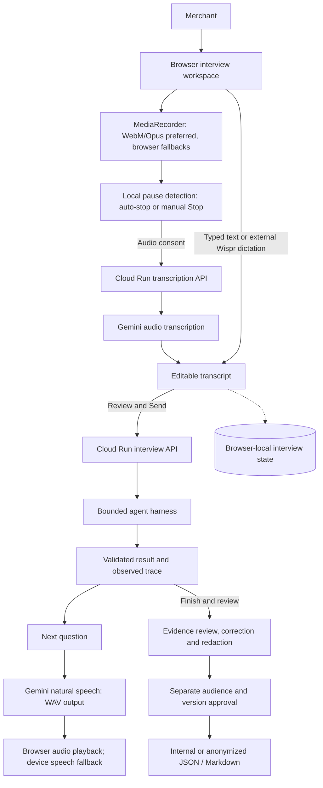
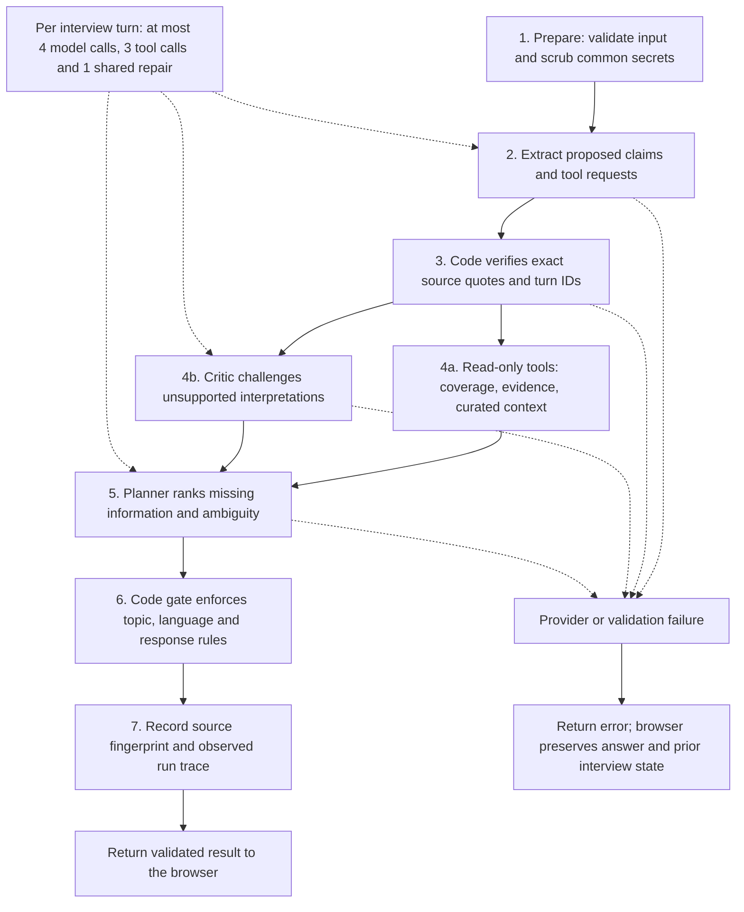

# MerchantLens

**Every merchant story. A clearer problem.**

A working voice-first merchant problem intake prototype with a bounded agent graph for Challenge 2 of the Paytm × AI Garage buildathon, with source traceability and merchant-controlled review.

## Submission

Sole participant: **Gowtham Ramachandra**.

- [Public app](https://merchantlens-paytm-412542191970.asia-south1.run.app/)
- [3:44 demo video](https://merchantlens-paytm-412542191970.asia-south1.run.app/merchantlens-demo.mp4)
- [Download demo from this repository](public/merchantlens-demo.mp4)

Current public deployment uses browser-local drafts; private cloud checkpoint APIs are intentionally unavailable. Live Gemini was smoke-tested. Human spoken-input accuracy remains unvalidated. See the latest section of docs/VALIDATION.md for current results.

## Presentation

[Download the detailed five-slide PowerPoint](docs/MerchantLens-Five-Slide-Pitch.pptx). It includes speaker notes on the business case, verifiability, voice/runtime architecture, agent contracts, guardrails, evaluations, ROI assumptions and proposed Paytm integration.

## Run

Requires Node.js 22.13+ (Node 24 tested).

```sh
npm ci
npm run dev -- --host 127.0.0.1
```

Open the Local URL printed by the dev server, normally http://127.0.0.1:5173.

### Optional live AI

Set these server-side variables in an ignored `.env.local` file or hosting runtime configuration, then restart the server:

```text
GEMINI_API_KEY=your-key
GEMINI_MODEL=gemini-3.5-flash-lite
```

Do not commit credentials. No provider key is required for the guided demo. Wispr Flow can dictate into the answer field, but is not the reasoning backend. Gemini is shown as unavailable until the server reports a configured key. Provider failure preserves the typed answer and never silently changes to the guided engine. The default model ID is configurable and must be available to your project.

## Languages and live participant demo

New interviews support **English, हिन्दी (Hindi), ಕನ್ನಡ (Kannada), and romanized Hinglish**. The selected language controls recorded-audio transcription, guided questions and live Gemini planning. Gemini natural playback is available, with selectable device speech as a fallback; device playback requires a matching installed voice. Source quotes keep their original script; the workspace and internal summaries may remain English.

[See the participant’s actual live voice session: transcript, screenshot and limitations](docs/LIVE-VOICE-DEMO.md). The 3:44 video above is the earlier typed-response walkthrough; no audio from the later participant session was stored.

56 automated tests and TypeScript passed. Live Hindi/Kannada Gemini text smoke tests returned native-script questions with exact source quotes. Native multilingual speech accuracy is not yet benchmarked.

## Recorded voice input

When Gemini is configured, allow recorded-audio processing, click the microphone, speak for up to 45 seconds, then pause for automatic stopping or press Stop. Pause detection can be disabled or adjusted to 1.2, 2 or 3.5 seconds. Gemini transcribes the clip into the answer field. Review and send explicitly. Audio is sent to Google but is not stored by MerchantLens. This avoids reliance on the browser Web Speech network service. Synthetic spoken audio passed a live transcription smoke test; real microphone and noisy-audio accuracy remain to be validated. The recorded demo predates this fallback.

## Working features

- Responsive operational workspace with light/dark modes and searchable brief library.
- Real text-answer loop plus supported browser microphone transcription and speech playback.
- Guided adaptive interview with amount clarification, answered-topic skipping, damaged-device branching, and early finish.
- Three separately scoped Gemini roles: extractor, independent critic, and question planner, plus code-enforced provenance and bounded repair.
- Read-only tool selection, parallel critique/retrieval, ranked follow-ups, explicit budgets and an inspectable execution trace.
- Source-dependency ablation and an executable seven-scenario guided evaluation.
- Optional account-owned D1 checkpoints with sign-in, idempotent saves, conflict detection and explicit restore.
- Evidence chain linking observations to precise transcript turns.
- Superseded observations, explicit uncertainty, and versioned review history.
- Selective redaction across retained transcript, current and previous claims, and history.
- Separate internal and anonymized briefs, per-audience approval bound to a version, JSON/Markdown downloads.
- Browser-local persistence, three labeled synthetic sample interviews, and an in-app demo guide.

## Architecture

### Public Cloud Run application



The public demo runs on **Google Cloud Run**, packaged with Docker. Google Secret Manager injects the server-side runtime key. Credentials never reach the browser. Recorded audio goes to Google only after audio consent and is not persisted by MerchantLens. Audio capture/transcription and interview reasoning are separate requests. Wispr is external dictation into the text field, not a connected Wispr API.

### Bounded agent harness



Critique and retrieval run **in parallel after source verification**. Gemini mode uses three separately scoped roles on the configured Gemini model; guided mode uses deterministic code adapters. These are roles in one harness, not independent model agents. The eight observed stages count retrieval and critique separately. The trace checkpoint above is a turn fingerprint, not a public cloud database write.

### Communication between the model roles

The orchestrator passes **validated structured JSON and typed interview state** between separately scoped Gemini requests. The extractor returns proposed claims and source quotes; the critic returns rejected topics and challenges; the planner receives ranked candidates, tool outputs and a concise critic summary. Code joins the parallel branches and enforces the final policy gate. No direct agent-to-agent audio, A2A protocol or message broker is implemented.

Microphone audio prefers **Opus in WebM**. Tested Gemini playback was **16-bit PCM, 24 kHz, mono in WAV**. These audio formats are separate from the JSON used by the interview roles; MP4/Ogg or device playback may use browser-dependent formats.

See the [communication sequence, actual role contracts, illustrative JSON and codec details](docs/AGENT-COMMUNICATION.md).

Corrections and redactions create a new interview version and invalidate earlier approvals. The merchant separately approves internal and anonymized exports. Source ablation reveals which observations lose their source when a turn is removed; it does not establish causality.

**Current storage boundary:** public interviews persist in the visitor's browser. Public checkpoint APIs reject reads and writes. Optional private deployments have separate account-scoped storage adapters: D1 on Sites or Cloud Storage on Cloud Run. Neither is a shared public-demo interview database. No Paytm transaction, refund or support-ticket API is connected.

See [the architecture details](docs/ARCHITECTURE.md), [live-demo evidence](docs/LIVE-VOICE-DEMO.md), and [validation record](docs/VALIDATION.md).

Core files:

- `components/workspace.tsx`: views, interview, voice controls and review flow.
- `app/globals.css`: responsive design system.
- `lib/interview.ts`: domain model, guided interviewer, privacy, brief generation and fixtures.
- `lib/agents/`: graph orchestration, separately scoped model roles, planning, critique, tools, source checks and evaluation.
- `lib/provider.ts`: input schemas.
- `lib/checkpoints.ts`, `app/api/checkpoints/`: account-scoped snapshot validation and storage.
- `app/api/interview/route.ts`: request validation and explicit provider selection.
- `tests/interview.test.ts`: domain acceptance checks.

## Verify

```sh
node --experimental-strip-types --test tests/languages.test.ts tests/transcription.test.ts tests/interview.test.ts tests/agents.test.ts tests/checkpoints.test.ts tests/cloudrun-store.test.ts tests/request-origin.test.ts tests/voice-activity.test.ts tests/speech.test.ts
# With the local dev server and migrated D1 running:
node --test tests/api.test.mjs
node --experimental-strip-types --test tests/checkpoints-api.test.mjs
node node_modules/typescript/bin/tsc --noEmit
node /Users/gowtham/.codex/plugins/cache/openai-curated-remote/sites/1.0.0/scripts/build-site.mjs
```

The last command uses the installed Sites helper; elsewhere use `npm run build`.

## Important limits

This is an independent buildathon prototype. It is not an official Paytm product and has no live payment, settlement, device, refund or support-ticket integration. All seeded merchant records are synthetic. Merchant speech is not independent verification. Public briefs conservatively generalize content; privacy patterns are not comprehensive. Private drafts can contain personal information and should be reviewed before export. Browser-local data is not encrypted application storage. Production use needs access controls, encryption, retention controls, rate limits, privacy review, and broader language/device evaluation.

The live Gemini integration and microphone/audio round trip require credentials and/or the user's actual demo hardware. Do not represent them as tested until validated. No external project benchmark is claimed as a MerchantLens result.

See `docs/BUILD-STANDARD.md`, `docs/DEMO.md`, and `docs/VALIDATION.md` for the business case, reference adaptation, demo sequence and actual verification results.

## Private checkpoint setup locally

The hosting manifest enables D1. Generate new schema migrations with `npm run db:generate`. After the first build, apply the tracked migration to the local preview database:

```sh
node --import ./scripts/sites-env.mjs ./node_modules/wrangler/bin/wrangler.js d1 execute DB --local --config dist/server/wrangler.json --persist-to .wrangler/state --file drizzle/0000_eager_kate_bishop.sql
```

Apply only once to a fresh local database. Hosted migrations are applied by Sites publication. Open the Agent control room, sign in using the local sign-in link when prompted, and save or restore a checkpoint explicitly.

See `docs/REFERENCE-REVIEW.md` for the Sanjay Prasad/LVL, Apollo and ModelProof comparison, including which prize claims were independently supported by the organizer.

### Voice improvements

Gemini now provides natural interviewer playback alongside adjustable local pause detection, noise suppression, editable transcripts, and device-voice fallback. See [voice behavior and validation](docs/VOICE-UPGRADE.md) for the exact flow and limitations. OpenAI audio is currently blocked by exhausted API credit; GPT-Live is not connected.
