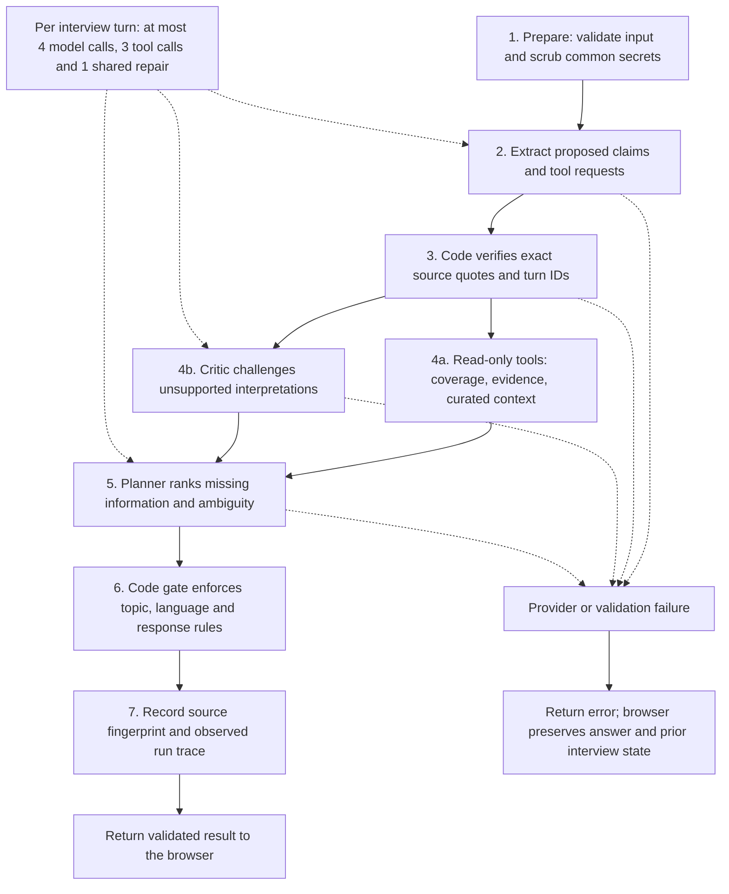

# MerchantLens architecture

## Scope

MerchantLens is an interviewer for recurring merchant payment-confirmation problems. Its business outcome is a merchant-approved, evidence-linked problem brief. It does not verify payments or make financial decisions.

The v2 runtime is a typed, bounded agent graph. In guided mode, its roles execute deterministic code. In Gemini mode, extraction, independent critique, and planning execute separately scoped model requests. Calling these roles separate does not imply independent models or immunity from correlated error.

The diagram describes the public Cloud Run harness. Public sessions stay in browser storage, and public checkpoint APIs return 403. The checkpoint stage records a source fingerprint and run trace. Private D1 or Cloud Storage save/restore adapters are optional deployment variants. See the [README runtime diagram](../README.md#architecture) for consented audio transcription, natural playback, approvals and export, and [Agent communication](AGENT-COMMUNICATION.md) for structured role messages.

## Boundaries and responsibilities

| Component | Responsibility | It cannot do |
|---|---|---|
| Prepare | Mask common secrets; reject ambiguous duplicate turn IDs | Guarantee complete PII removal |
| Extractor | Propose topic claims with exact quotes and source turn IDs | Declare independent transaction verification |
| Provenance verifier | Check sources exist, quotes match, topic uniqueness, trust boundary | Prove semantic entailment solely from a string match |
| Read-only tools | Inspect evidence, read coverage, retrieve curated source context | Browse arbitrary URLs, access bank accounts, send tickets or payments |
| Critic | Challenge semantic support and consequential contradictions | Approve output or independently authenticate merchant reports |
| Planner | Select a question from candidate topics and rephrase naturally | Ignore critical ambiguity or grant approval |
| Code gate | Enforce topic constraints, call and turn budgets, safe response form | Establish factual truth |
| Reviewer | Correct, redact and approve a version for an audience | Convert a merchant account into independent verification |
| D1 checkpoint store | Save and restore an account-owned turn-boundary snapshot | Provide an autonomous cross-account memory or team sharing |

## What is agentic here

1. **Plan and execute:** extraction produces explicit state; planning chooses the next action from currently relevant questions, rather than advancing a fixed questionnaire.
2. **Separate reviewer role:** a second prompt reviews semantic support before candidate claims are used. Unsupported claims are removed and become gaps for further questioning.
3. **Conditional control:** unresolved money ambiguity or contradictory payment accounts preempt routine field collection. A code gate can override a model's unsafe topic selection.
4. **Bounded tool use:** live extraction requests a subset of three typed read-only tools. The dispatcher executes only allowlisted functions. Required coverage inspection is added by code.
5. **Parallel branches:** context retrieval and evidence critique run concurrently after provenance validation. Their outputs join at planning.
6. **Bounded repair:** a schema/source-invalid model response gets at most one shared repair across the extractor, critic and planner. Persistent invalidity aborts the run; it does not commit fabricated evidence.
7. **Explicit memory:** typed observations, source dependencies, superseded statements, and audit events preserve the interview state outside model context.
8. **Resumability:** D1 stores explicit account-owned snapshots at completed-turn boundaries. Restore resumes the last completed turn; this is not mid-token/model-call recovery.
9. **Source ablation:** removing a source identifies dependent observations. It is a dependency test, not causal inference or a claim of formal legal reasoning.
10. **Executable evaluation:** seven hand-authored deterministic probes run through the same graph. Model-contract tests use injected fake clients and are labeled separately from live-model evaluation.

## Question ranking

Scores prioritize consequential ambiguity, missing payment signals, operational impact, recurrence, and repeated questions. They are transparent engineering heuristics, not calibrated probabilities, expected entropy reductions, or learned policies. The planner sees a ranked list and chooses a listed topic. An unresolved critical challenge constrains the final choice in code.

## Hard budgets

- Four total model calls per turn, including at most one shared role repair.
- Three read-only tool calls per turn.
- Fourteen merchant turns before returning an incomplete draft for review.
- Fifty-five-second graph deadline; client waits sixty-five seconds.
- Bounded schema sizes, transcript length, and checkpoint payload size.

No autonomous background loops or external writes are available to the model.

## Storage and concurrency

Public demo interviews stay in browser local storage; public checkpoint APIs reject reads and writes. Optional private deployments support account-scoped D1 on Sites or Cloud Storage on Cloud Run. In the D1 variant, the primary key is `(owner_id, session_id)` and queries use trusted Sites identity. Cloud Storage uses owner namespaces and generation preconditions. These are deployment alternatives, not a shared public-demo database.

Updates reject older versions, recognize identical retries, and use a conditional database update to detect concurrent changes. Approval-only changes at the same content version require the last observed checkpoint timestamp. A redacted browser interview does not retroactively erase an earlier cloud snapshot: save the new version to replace that snapshot. Existing downloaded copies are outside this control.

The checkpoint fingerprint is a non-cryptographic dependency fingerprint. It is not a signature, authentication token, or tamper-evident ledger. Browser state can be altered by its owner. Formal signed approvals and enterprise audit retention are future production requirements.

## Retrieval and grounding

Five local context cards contain short paraphrases of official Paytm support information and explicit product design rules, reviewed on 18 October 2026. Local lexical matching retrieves up to three cards. This is not a large vector database, a live web-search agent, or proof of a merchant's account. Official-source cards and design rules are labeled separately.

## Voice and Wispr Flow

When Gemini is configured, MediaRecorder captures audio with browser-supported echo cancellation, noise suppression and gain control. Local energy-based voice activity detection can stop on a selected pause; manual Stop is available. The preferred recording codec/container is Opus in WebM, with MP4/Ogg or browser-default fallbacks. Gemini transcribes the bounded clip. Natural question playback uses Gemini TTS and WAV audio; tested output was 16-bit PCM at 24 kHz, mono. Device speech synthesis is selectable and is a fallback. Browser SpeechRecognition remains a legacy option when Gemini is not configured. Activating the microphone interrupts playback. The merchant reviews transcription before sending. Wispr Flow works as an external dictation app writing into the same answer field. No Wispr microphone API or transcription stream is called. Its available connector is read-only access to recorded notes, not an LLM backend. Received text is the evidence source; it may be edited dictation, not a verbatim audio record.

For the complete sequence, JSON role contracts and codec distinctions, see [Agent communication](AGENT-COMMUNICATION.md). For voice limits and observed smoke tests, see [Voice upgrade](VOICE-UPGRADE.md).

## Deliberate omissions

No decorative framework, autonomous payment execution, unverifiable emotion inference, speculative fraud scoring, or automatic external escalation was added. LangGraph/MCP branding would not make this bounded single-domain graph more reliable. A custom typed graph avoids a separate Python worker and preserves the existing deployment. The tool protocol can later be exposed through MCP if a real interoperability use case appears.

## Deployment

The public demo runs Vinext/React and same-origin APIs in a Docker container on Google Cloud Run in asia-south1. Secret Manager supplies the server-side Gemini key. Public browser access is enabled; checkpoint APIs remain disabled in public mode. Sites Worker/D1 and private Cloud Run/Cloud Storage are optional deployment variants. No Paytm API is connected.

## Validation limit

The model roles, retry bounds, critic rejection, gate override and token accounting have deterministic contract tests using injected clients. 56 automated tests and TypeScript passed. Synthetic English, Hindi and Kannada transcription/TTS smoke tests and public WAV playback succeeded. These do not establish live-model interview accuracy, real multilingual word error rate, human listening preference or noisy-shop reliability. OpenAI audio requests were blocked by exhausted credit; GPT-Live is not connected. This architecture is materially stronger than v1, but that is not evidence of a guaranteed winning submission.

## Timing interpretation

Trace durations use the runtime clock and exclude browser/network transport. Some Worker runtimes do not advance the clock during code-only work; zero readings are displayed as clock-limited, not as evidence of zero latency. Live-model end-to-end latency still needs measurement.
