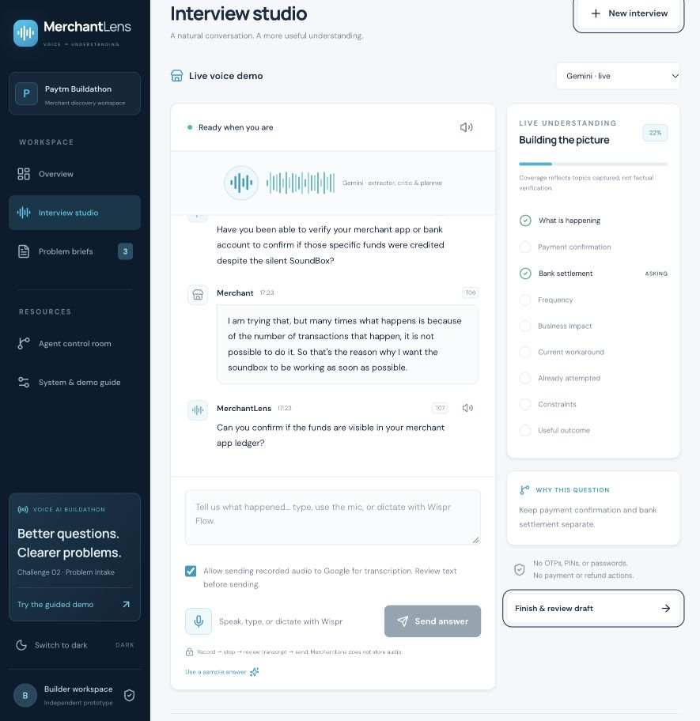
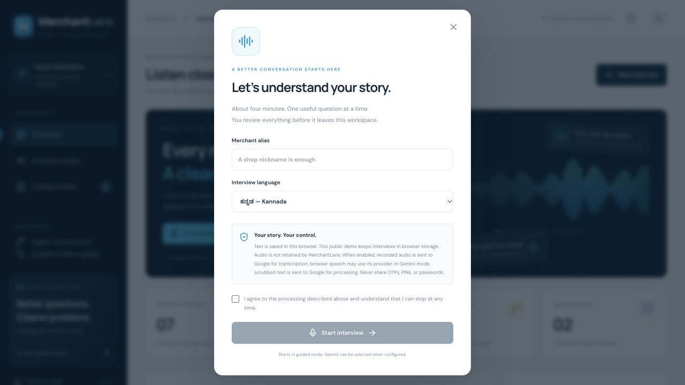

# Live voice session — 18 October 2026

Participant: **Gowtham Ramachandra** (sole team member).

The participant ran the new recorded-audio transcription flow using a fictional grocery-shop scenario. The deployed interface was inspected after the test: it contained three committed merchant answers, live Gemini follow-ups, an enabled audio-consent checkbox, and 22% topic coverage. This is a partial interview, not a completed or approved brief. No human-audio file was retained, so this page documents the visible transcript rather than presenting a recovered recording or an independent speech-accuracy score.

[Open the public app](https://merchantlens-paytm-412542191970.asia-south1.run.app/) · [Earlier 3:44 product walkthrough](https://merchantlens-paytm-412542191970.asia-south1.run.app/merchantlens-demo.mp4)

The earlier video uses typed synthetic responses and synthetic narration. It predates the participant's recorded-audio test and the Kannada/Hindi language update.

## Visible transcript excerpt

**Interviewer:** Tell me about a recent payment problem at your shop. What happened?

**Merchant:** I run a small grocery shop. Since last week my SoundBox sometimes stays silent after customers pay. Yesterday this happened for payments worth 2,400. I thought I had lost that money, but I'm not sure.

**Interviewer:** When you say the payment did not arrive, do you mean the entry in your merchant app, the credit in your bank, or the Soundbox announcement?

**Merchant:** 2400 When I say the payment did not arrive, did you mean the entry in the merchant account the credit? I'm referring to the sound box announcement so I'm not sure if the amount got credited.

**Interviewer:** Have you been able to verify your merchant app or bank account to confirm if those specific funds were credited despite the silent SoundBox?

**Merchant:** I am trying that, but many times what happens is because of the number of transactions that happen, it is not possible to do it. So that's the reason why I want the soundbox to be working as soon as possible.

**Interviewer:** Can you confirm if the funds are visible in your merchant app ledger?

The excerpt preserves the visible wording, including disfluencies. The final question repeated a request to check payment records after the participant described difficulty doing so. The extractor instruction was subsequently tightened to capture unavailable evidence explicitly and allow the planner to move to another gap. This is a prompt improvement, not a demonstrated resolution of that exact live-session behavior.

## Language support added after this session

- English, native-script Hindi, native-script Kannada, and romanized Hindi/Hinglish are selectable for new interviews.
- Recorded-audio transcription receives the selected language and script instruction.
- Guided greetings, questions, money clarification, contradictions, damaged-device follow-ups and closing prompts use localized text.
- Live planning is instructed to use the selected script; a code gate substitutes a localized candidate when it receives an English-only answer for Hindi/Kannada.
- Exact source quotes remain in their original script. Internal claim summaries and the operations interface may remain English.
- Browser spoken output chooses a matching available voice. If the device has no Hindi/Kannada voice, the app displays a notice and retains the on-screen question. No universal native-voice availability is claimed.
- Wispr Flow remains optional external dictation into the answer box; no Wispr API integration is claimed.

Fifty-two automated tests and TypeScript passed before deployment. Native-script merchant interviews and noisy multilingual speech still need broader human evaluation; the participant's observed test above was English.

## Additional synthetic audio smoke checks

The actual Gemini transcription endpoint was exercised with WebM/Opus clips generated using the macOS Hindi voice Lekha and Kannada voice Soumya. Returned transcripts included:

- Hindi: “मेरी दुकान में Soundbox से आवाज़ नहीं आ रही है। ऐप में भुगतान सफल दिख रहा है।”
- Kannada: “ನನ್ನ ಅಂಗಡಿಯಲ್ಲಿ ಸೌಂಡ್ ಬಾಕ್ಸ್ ನಲ್ಲಿ ಧ್ವನಿ ಬರುತ್ತಿಲ್ಲ ಆಯಪ್ ನಲ್ಲಿ ಪಾವತಿ ಯಶಸ್ವಿಯಾಗಿದೆ”

These tests establish native-script audio processing for the synthetic clips. They are not a fluent-speaker review, an accent/noise benchmark, or proof of verbatim accuracy. In particular, Kannada spelling and punctuation should be reviewed by the merchant before sending. The participant's earlier human test was English.

A later hosted Kannada test returned a mixture of Kannada and unrelated Arabic characters. This prompted an additional script-validation guard: recorded-audio transcription may retry once within the same 45-second deadline and rejects repeated wrong-script output. Hindi/Kannada may retain Latin words actually spoken in English. This guard does not establish spelling or semantic accuracy; review remains required.

## Try a native-language interview

Open the public app, choose **New interview**, select **हिन्दी — Hindi** or **ಕನ್ನಡ — Kannada**, enter an alias and consent, then start. Select Gemini for live model roles. Allow recorded-audio transcription, click the microphone, speak, stop, review the transcript and send. Hinglish remains available separately. Device voices determine whether native spoken output is available.

